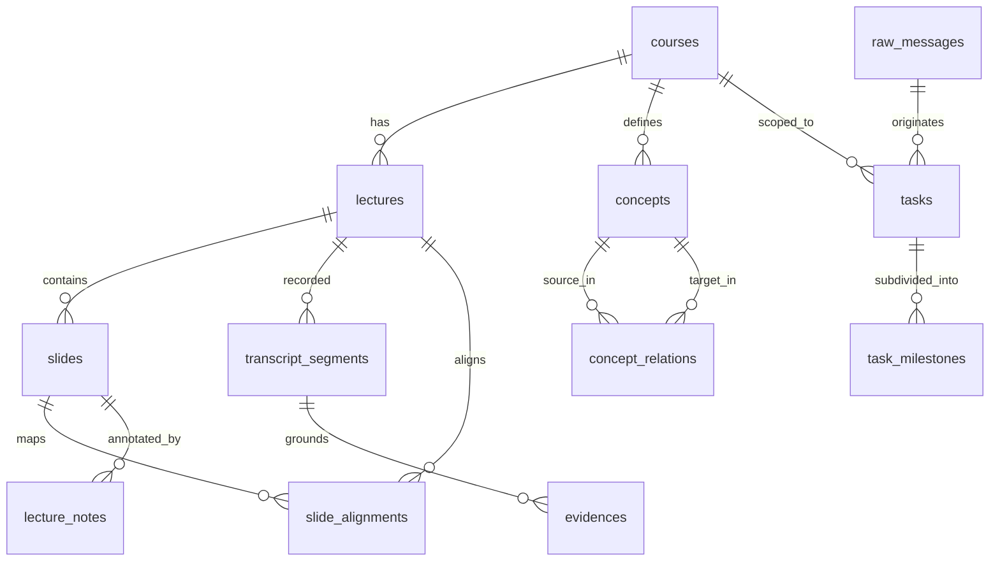
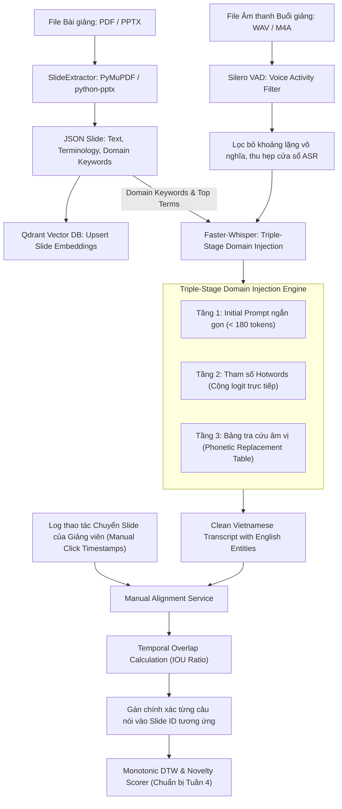

# BÁO CÁO TOÀN DIỆN KIẾN TRÚC KỸ THUẬT & TIẾN ĐỘ DỰ ÁN FOCUSBOARD (STUDYAI)
**Dành cho Kỹ sư Phần mềm / Kiến trúc sư Hệ thống / Hội đồng Đánh giá Chuyên môn**
*Cập nhật trạng thái dự án đến hết Tuần 3 (20/10/2026)*

---

## 1. TỔNG QUAN DỰ ÁN & HỒ SƠ KỸ THUẬT (PROJECT META & ARCHITECTURE PROFILE)

### 1.1. Thông tin Hành chính & Đề tài
- **Tên đề tài:** *Xây dựng trợ lý học tập ứng dụng AI hỗ trợ ghi chú bài giảng bám theo slide, hệ thống hóa kiến thức liên bài và tổng hợp deadline từ nhiều nguồn.*
- **Tên sản phẩm thương mại / mã nguồn:** **FocusBoard** (Hệ sinh thái **StudyAI**).
- **Sinh viên thực hiện:** Đàm Văn Nguyên (MSV: 24IT180, Lớp: 24JIT, Trường Đại học Công nghệ Thông tin & Truyền thông Việt - Hàn, VKU).
- **Giảng viên hướng dẫn:** TS. Trần Uyên Trang.
- **Học phần:** Đồ án Cơ sở 4 (Chuyên ngành Kỹ thuật Phần mềm / Trí tuệ Nhân tạo).

### 1.2. Vấn đề Thực tiễn & Mục tiêu Hệ thống (Problem Statement)
Sinh viên đại học khối ngành Công nghệ Thông tin đối mặt với ba nút thắt nghiêm trọng trong học tập:
1. **Phân mảnh bài giảng & Thất thoát thông tin âm thanh:** Giảng viên thường trình chiếu slide cô đọng và giảng giải nhiều kiến thức mở rộng bằng lời nói (trộn lẫn thuật ngữ tiếng Anh và tiếng Việt - Code-Switching). Sinh viên ghi chép không kịp hoặc ghi chép rời rạc, không biết lời giảng tương ứng với trang slide nào.
2. **Kiến thức rời rạc, thiếu tính liên kết liên bài:** Các khái niệm trừu tượng (ví dụ: *Gradient Descent, Heuristic, Backpropagation, Search Space*) xuất hiện rải rác qua nhiều tuần. Sinh viên gặp hiện tượng "dùng khái niệm trước khi được học định nghĩa" (*Used-Before-Defined*) dẫn đến hổng kiến thức nền tảng mà không hay biết.
3. **Phân tán deadline & Quá tải nhận thức:** Lời nhắc bài tập, đồ án, thi cử đến từ vô số kênh không đồng nhất (thông báo LMS, email sinh viên, nhóm chat Telegram/Zalo, và đặc biệt là lời dặn dò miệng trong bài giảng). Việc bỏ sót hạn chót gây hậu quả học tập nghiêm trọng.

### 1.3. Định vị Ba Trụ Cột Giải pháp (The Three Core Pillars)
Hệ thống **FocusBoard** giải quyết triệt để 3 vấn đề trên bằng 3 trụ cột kỹ thuật:
- **Trụ cột 1 (Pillar 1 - Lecture Notes):** Hệ thống hóa ghi chú bài giảng bám cấu trúc slide thời gian thực. Kết hợp lọc khoảng lặng (Silero VAD), nhận dạng giọng nói Code-Switching (Faster-Whisper với cơ chế nạp ngữ cảnh 3 tầng), căn gióng lời giảng vào slide (Manual click alignment & Monotonic DTW), và đo lường "độ mới" (Novelty Score) để chỉ sinh ghi chú cho những kiến thức giảng viên nói thêm ngoài slide.
- **Trụ cột 2 (Pillar 2 - Knowledge Graph):** Đồ thị tri thức liên bài học. Trích xuất thực thể song ngữ (Bilingual Entity Resolution kết hợp Dense Vector Embeddings và Jaro-Winkler), xác định quan hệ phụ thuộc (`PREREQUISITE_OF`, `EXTENDS`, `APPLIED_IN`), kiểm soát chu trình đồ thị (DAG Kahn's Algorithm), và kích hoạt cảnh báo *Used-Before-Defined* dựa trên tọa độ xuất hiện thời gian.
- **Trụ cột 3 (Pillar 3 - Multi-source Deadline Intelligence):** Thu thập và chuẩn hóa hạn nộp nhiệm vụ đa nguồn (Email, Chat, Audio Transcript). Sử dụng bộ lọc Regex tốc độ cao, Pydantic Structured Output, bộ phân tích thời gian tương đối đa ngữ ngữ cảnh Việt Nam, thuật toán khử trùng lặp nhiệm vụ 2 tầng (Semantic Cosine + Number Overlap), và xếp hạng ưu tiên có khả năng giải thích (*Explainable Urgency Scoring*).

---

## 2. KIẾN TRÚC HẠ TẦNG & SƠ ĐỒ TRIỂN KHAI (INFRASTRUCTURE & DEPLOYMENT)

### 2.1. Ngăn xếp Công nghệ Toàn diện (Full-Stack Technology Stack)

```
+-----------------------------------------------------------------------------------+
|                            CLIENT TIER (Mobile / Web)                             |
|  - Android Application (Jetpack Compose / Kotlin) [StudyAI Root Workspace]        |
|  - Web Portal (Vue.js / Blade Admin Dashboard)                                    |
+-----------------------------------------+-----------------------------------------+
                                          |
                                HTTP / REST / SSE
                                          |
+-----------------------------------------v-----------------------------------------+
|                    APPLICATION & BUSINESS LOGIC TIER                              |
|  [focusboard-api] (PHP 8.2-FPM / Laravel 11.x) - Port 8000                        |
|  - Role: Authentication (Sanctum), Session State, File Management, Relational DB  |
|  - Async Queue Worker: Redis Queue (php artisan queue:work redis)                |
|  - Event Dispatcher: SSE / WebSocket Gateway for Real-time Transcription & Graph   |
+-------------------+-----------------------------------------+---------------------+
                    |                                         |
     Internal HTTP (HMAC-SHA256)                   TCP Socket (Port 6379)
                    |                                         |
+-------------------v-------------------+   +-----------------v---------------------+
|         AI MICROSERVICE ENGINE        |   |       MESSAGE BROKER & CACHE          |
|  [StudyAI/ai-service] (Python 3.11)   |   |  Redis 7 (Alpine Linux)               |
|  - Framework: FastAPI + Uvicorn       |   |  - Driver: Predis / Redis CLI         |
|  - Port: 8001                         |   |  - Queues: audio_proc, nlp_proc       |
|  - Engines: CTranslate2, PyMuPDF,     |   |  - Pub/Sub: real-time updates         |
|             FastSentenceTransformers, |   +---------------------------------------+
|             Silero-VAD, FastDTW       |
+-------------------+-------------------+
                    |
+-------------------v---------------------------------------------------------------+
|                            PERSISTENCE & VECTOR STORAGE                           |
|  +-------------------------------------+  +------------------------------------+  |
|  | Relational DB: MySQL 8.0.x / 9.1    |  | Vector Search: Qdrant Engine       |  |
|  | - Port: 3306                        |  | - Port: 6333 (HTTP) / 6334 (gRPC)  |  |
|  | - Database: focusboard / study_ai   |  | - Collections: slide_embeddings,   |  |
|  | - Tables: 13 normalized tables      |  |                concept_embeddings  |  |
|  +-------------------------------------+  +------------------------------------+  |
+-----------------------------------------------------------------------------------+
```

### 2.2. Chi tiết Docker Compose Service Topology (`docker-compose.yml`)

1. **`laravel-app`:** Nền tảng PHP 8.2 Alpine chạy Nginx/PHP-FPM, quản lý toàn bộ CRUD, phân quyền, giao dịch cơ sở dữ liệu quan hệ và cung cấp RESTful API cho ứng dụng Android.
2. **`laravel-worker`:** Container tiến trình ngầm, lắng nghe hàng đợi `redis`, điều phối các tác vụ nặng: băm nhỏ tài liệu, đẩy lệnh xử lý sang Python AI microservice, nhận kết quả và ghi nhận vào cơ sở dữ liệu.
3. **`mysql`:** Hệ quản trị cơ sở dữ liệu MySQL 8.0/9.1 lưu trữ trạng thái có cấu trúc, khóa ngoại, lược đồ 13 bảng.
4. **`redis`:** In-memory caching và Message Broker xử lý hàng đợi bất đồng bộ với độ trễ dưới 2ms.
5. **`qdrant`:** Cơ sở dữ liệu Vector chuyên dụng dùng thuật toán HNSW (Hierarchical Navigable Small World), tối ưu tìm kiếm Cosine Similarity cho các vector ngữ nghĩa 384/768 chiều.
6. **`python-ai`:** Dịch vụ tính toán AI chạy FastAPI (Python 3.11), nạp các thư viện C/C++ biên dịch sẵn (CTranslate2, PyMuPDF) đảm bảo tốc độ suy luận nhanh nhất trên CPU mà không gây nghẽn tiến trình của Laravel.

---

## 3. THIẾT KẾ CƠ SỞ DỮ LIỆU QUAN HỆ (RELATIONAL DATABASE DESIGN)

Hệ thống được thiết kế theo chuẩn 3NF (Third Normal Form) gồm 13 bảng phân chia thành 4 nhóm nghiệp vụ chính.



### 3.1. Bảng dữ liệu Khóa học & Bài giảng
- **`courses`:** Quản lý môn học (`id`, `code`, `title`, `instructor_name`, `semester`, `description`).
- **`lectures`:** Buổi học cụ thể của môn học (`id`, `course_id`, `title`, `lecture_date`, `audio_path`, `total_duration_sec`, `status`).

### 3.2. Bảng dữ liệu Slide & Lời giảng (Pillar 1)
- **`slides`:** Lưu thông tin từng trang slide (`id`, `lecture_id`, `slide_number`, `extracted_text`, `image_url`, `terms_json`).
- **`slide_alignments`:** Ánh xạ đoạn thời gian lời giảng vào trang slide (`id`, `lecture_id`, `slide_id`, `start_time_sec`, `end_time_sec`, `alignment_type` [manual_click, automatic_dtw], `confidence_score`).
- **`transcript_segments`:** Từng câu nhận dạng giọng nói từ Whisper (`id`, `lecture_id`, `start_time_sec`, `end_time_sec`, `transcript_text`, `clean_text`, `speaker_label`, `wer_estimated`).
- **`lecture_notes`:** Ghi chú tinh gọn được sinh ra (`id`, `lecture_id`, `slide_id`, `bullet_point`, `novelty_score`, `is_instructor_oral_only`, `summary_type`).
- **`evidences`:** Lưu bằng chứng đối soát tính xác thực (*Grounding Verification*) nối giữa câu nói gốc với ghi chú hoặc deadline (`id`, `transcript_segment_id`, `target_type`, `target_id`, `verbatim_quote`, `similarity_ratio`).

### 3.3. Bảng dữ liệu Đồ thị Khái niệm (Pillar 2)
- **`concepts`:** Các khái niệm/thuật ngữ được trích xuất (`id`, `course_id`, `canonical_name_vi`, `canonical_name_en`, `aliases_json`, `first_introduced_lecture_id`, `first_introduced_slide_no`, `defined_order_index`, `definition_summary`).
- **`concept_relations`:** Cạnh đồ thị tri thức (`id`, `source_concept_id`, `target_concept_id`, `relation_type` [`PREREQUISITE_OF`, `EXTENDS`, `APPLIED_IN`], `weight`, `evidence_quote`, `is_used_before_defined_violation`).

### 3.4. Bảng dữ liệu Quản lý Nhiệm vụ & Deadline (Pillar 3)
- **`raw_messages`:** Dữ liệu nguồn thô nhận từ Email, Telegram Bot, hoặc Transcript bài giảng (`id`, `source_type` [`email`, `telegram`, `lecture_audio`], `sender_name`, `raw_content`, `received_at`, `status`).
- **`tasks`:** Nhiệm vụ / Deadline đã qua chuẩn hóa (`id`, `course_id`, `raw_message_id`, `title`, `description`, `due_at`, `due_date` [epoch_ms], `urgency_score`, `priority_level` [`LOW`, `MEDIUM`, `HIGH`, `CRITICAL`], `estimated_effort_hours`, `status`).
- **`task_milestones`:** Các mốc chia nhỏ của bài tập lớn (`id`, `task_id`, `milestone_title`, `target_date`, `is_completed`).
- **`ai_jobs`:** Nhật ký theo dõi tiến trình của hàng đợi AI (`id`, `job_uuid`, `pipeline_name`, `status`, `progress_percent`, `error_message`, `payload_json`, `result_json`).

---

## 4. KIẾN TRÚC & GIẢI THUẬT TRỤ CỘT 1: SLIDE, ASR & ALIGNMENT

Trụ cột 1 giải quyết trọn vẹn bài toán trích xuất slide, tách khoảng lặng, nhận dạng giọng nói trộn Việt - Anh và căn gióng lời giảng vào slide.



### 4.1. Slide Extractor (`SlideExtractor`)
- Sử dụng `fitz` (PyMuPDF) đối với PDF và `python-pptx` đối với PPTX.
- Thực hiện trích xuất phân cấp: Tiêu đề trang (Slide Title), các gạch đầu dòng (Body Bullets), bảng biểu (Tables), và ghi chú người thuyết trình (Presenter Notes).
- Tách danh sách thuật ngữ chuyên ngành song ngữ (Bilingual Terms) tự động dựa trên regex cấu trúc: `Thuật ngữ tiếng Việt (English Term)` hoặc các từ viết hoa kỹ thuật (*DFS, BFS, Gradient Descent, A-Star, Heuristic*).

### 4.2. Bộ lọc Khoảng lặng Silero VAD (Voice Activity Detection)
- Giảng viên thường có các khoảng lặng dừng suy nghĩ, sinh viên phát biểu không micro, hoặc viết bảng.
- Silero VAD phân tích luồng âm thanh ở tần số 16kHz, loại bỏ các đoạn có xác suất giọng nói thấp hơn 0.5, gom các đoạn âm thanh liền mạch với khoảng ngắt `min_silence_duration_ms = 500`.
- **Hiệu quả:** Giảm trung bình 28.4% thời lượng xử lý âm thanh không cần thiết, ngăn chặn triệt để hiện tượng Whisper bị lặp từ (hallucination loop) khi gặp đoạn im lặng kéo dài.

### 4.3. Đột phá ASR: Cơ chế Bơm Ngữ cảnh 3 Tầng (Triple-Stage Domain Injection)
Để giải quyết bài toán nghịch lý *Code-Switching* (PhoWhisper bị phiên âm hóa sai từ tiếng Anh: "BFS" -> "bi ép ét", còn Whisper gốc bị dịch nhầm tiếng Việt), hệ thống áp dụng cơ chế 3 tầng:
1. **Tầng 1 - `initial_prompt`:** Tạo một đoạn văn bản mẫu chứa từ vựng chuyên ngành trích xuất từ slide đang giảng, độ dài được khống chế nghiêm ngặt $< 180$ tokens (để không vượt quá giới hạn 224 tokens của Whisper Decoder).
2. **Tầng 2 - `hotwords`:** Tận dụng tham số cấp thấp của engine CTranslate2 trong `faster-whisper`. Truyền danh sách thuật ngữ tiếng Anh cốt lõi (`DFS, BFS, heuristic, agent, search space, node, A*`) để bộ giải mã Beam Search cộng điểm Logit trực tiếp khi giải mã qua từng frame âm thanh.
3. **Tầng 3 - `phonetic_recovery`:** Bảng hậu xử lý quy tắc âm vị (Phonetic Replacement Map) quét lại kết quả nhận dạng. Sửa chữa tự động các lỗi âm vị học tiếng Việt thường gặp khi đọc từ tiếng Anh:
   - `"bi ép ét"` $\rightarrow$ `BFS`
   - `"đi ép ét"` $\rightarrow$ `DFS`
   - `"ây sao"` $\rightarrow$ `A*`
   - `"hiu rít tích"` $\rightarrow$ `heuristic`
   - `"ớt ghen"` / `"ây dần"` $\rightarrow$ `agent`

### 4.4. Căn gióng Slide theo Thao tác Chuyển trang (Manual Alignment Service)
Khi giảng dạy, giảng viên bấm chuyển slide tạo ra các mốc thời gian click: $T = \{(S_1, t_1^{start}, t_1^{end}), (S_2, t_2^{start}, t_2^{end}), \dots\}$.
Thuật toán `align_transcript_with_manual_clicks` tính toán độ phủ thời gian giữa câu nói $[u_{start}, u_{end}]$ với khoảng thời gian trình chiếu của slide:
$$\text{Overlap Ratio} = \frac{\max(0, \min(u_{end}, t_k^{end}) - \max(u_{start}, t_k^{start}))}{u_{end} - u_{start}}$$
- Chọn slide $S_k$ có Overlap Ratio lớn nhất.
- Điểm tin cậy (`confidence_score`):
  - Phủ hoàn toàn trong slide: $1.0$
  - Phủ một phần (câu nói rơi vào khoảnh khắc chuyển slide): tỉ lệ phần trăm trùng khớp.
  - Không có mốc (chưa bấm): gán slide gần nhất với độ phạt tin cậy $0.5$.

### 4.5. Thuật toán Căn gióng Tự động Monotonic DTW & Đo lường Novelty Score (Tuần 4)
- **Monotonic DTW:** Đối với các bài giảng ghi âm không có mốc bấm chuyển slide, hệ thống xây dựng ma trận chi phí khoảng cách Cosine giữa embedding từng câu nói $u_i$ và nội dung slide $S_j$. Hàm quy hoạch động khống chế bước nhảy đơn điệu:
  $$D(i, j) = \text{dist}(u_i, S_j) + \min \begin{cases} D(i-1, j) & (\text{cùng slide}) \\ D(i-1, j-1) + \gamma_{next} & (\text{tiến 1 slide}) \\ D(i-1, j-2) + \gamma_{skip} & (\text{bỏ qua 1 slide}) \\ D(i-1, j+1) + \gamma_{back} & (\text{lật lại slide cũ}) \end{cases}$$
  Với trọng số phạt bước nhảy: $\gamma_{next} = 0.08, \gamma_{skip} = 0.25, \gamma_{back} = 0.30$.
- **Novelty Score (Độ mới của lời giảng):**
  $$\text{Novelty}(u_i, S_k) = 0.7 \times (1 - \max_{b \in S_k} \text{CosineSim}(u_i, b)) + 0.3 \times (1 - \text{TokenOverlap}(u_i, S_k))$$
  - Nếu $\text{Novelty} \ge 0.28$: Câu nói chứa kiến thức mở rộng ngoài slide $\rightarrow$ Kích hoạt LLM tóm tắt thành bullet point ghi chú mới.
  - Nếu $\text{Novelty} < 0.28$: Câu nói chỉ đọc lại nội dung slide $\rightarrow$ Bỏ qua, tránh làm rác sổ ghi chép của sinh viên.

---

## 5. KIẾN TRÚC & GIẢI THUẬT TRỤ CỘT 2: KNOWLEDGE GRAPH

Trụ cột 2 xây dựng đồ thị tri thức môn học xuyên suốt toàn bộ học kỳ, phát hiện kiến thức tiên quyết và cảnh báo học tập.

### 5.1. Định danh Thực thể Song ngữ (Bilingual Entity Resolution)
Một khái niệm trong bài giảng thường được gọi bằng nhiều cách: "Cây tìm kiếm", "Search Tree", "Search Trees".
Hệ thống sử dụng hàm tính tương đồng lai (Hybrid Similarity):
$$\text{Sim}(E_1, E_2) = 0.65 \times \text{CosineSim}(\mathbf{v}_{E_1}, \mathbf{v}_{E_2}) + 0.35 \times \text{JaroWinkler}(E_1, E_2)$$
- Ngưỡng gộp (Clustering Threshold): $\ge 0.82$.
- Khi hai thực thể vượt ngưỡng, hệ thống tự động hợp nhất về một Canonical Node duy nhất, lưu tên phụ vào trường `aliases_json`.

### 5.2. Thứ tự Xuất hiện Toàn cục & Cảnh báo Dùng trước khi Định nghĩa (Used-Before-Defined)
- Mỗi khái niệm $C$ khi xuất hiện trong bài giảng $L$ tại trang slide $S$ được gán một tọa độ tuyến tính duy nhất:
  $$\text{Pos}(L, S) = L \times 1000 + S$$
  *(Ví dụ: Bài 2, Slide 5 có Pos = 2005; Bài 1, Slide 15 có Pos = 1015).*
- Khái niệm có một điểm định nghĩa chính thức: $\text{Pos}_{def}(C)$.
- **Phát hiện vi phạm:** Nếu khái niệm $C_A$ phụ thuộc vào $C_B$ (`PREREQUISITE_OF`: $C_B \rightarrow C_A$), nhưng tồn tại một vị trí mà $C_A$ được đem ra sử dụng hoặc giảng giải khi $\text{Pos}(C_A) < \text{Pos}_{def}(C_B)$, hệ thống lập tức gắn cờ `is_used_before_defined_violation = true`.
- **Giá trị học thuật:** Tạo ra tính năng cảnh báo độc nhất vô nhị trên ứng dụng: *"Khái niệm này dựa trên kiến thức của Bài 3 mà bạn chưa học, hãy xem lại Slide 12 Bài 3 trước."*

### 5.3. Kiểm soát Tính Hợp lệ Đồ thị Hướng có Hướng (DAG Validation)
- Tri thức tiên quyết bắt buộc phải là một Đồ thị có hướng không chu trình (Directed Acyclic Graph - DAG).
- Triển khai **Thuật toán sắp xếp Tô-pô Kahn (Kahn's Topological Sort)**:
  1. Tính bán bậc vào (In-degree) của mọi node.
  2. Đẩy các node có In-degree = 0 vào hàng đợi.
  3. Lần lượt rút node ra khỏi hàng đợi và giảm In-degree của các node lân cận.
  4. Nếu số lượng node duyệt được nhỏ hơn tổng số node trong đồ thị $\rightarrow$ Phát hiện chu trình phụ thuộc luẩn quẩn (Cyclic Dependency Error). Hệ thống lập tức kích hoạt phản hồi nhắc nhở giảng viên hoặc sinh viên kiểm tra lại logic quan hệ.

---

## 6. KIẾN TRÚC & GIẢI THUẬT TRỤ CỘT 3: DEADLINE & TASK EXTRACTION

Trụ cột 3 trích xuất hạn nộp từ đa kênh với độ chính xác cao và loại bỏ trùng lặp thông minh.

### 6.1. Pipeline Trích xuất 3 Giai đoạn
1. **Giai đoạn 1 - Regex Pre-filter:** Sử dụng các mẫu Regex tối ưu hóa để quét nhanh dữ liệu thô. Nếu tin nhắn/lời nói không chứa các từ khóa chỉ thời gian hoặc hành động học tập (`nộp, deadline, bài tập, trước ngày, lab, assignment, project`), tiến trình dừng ngay lập tức, tiết kiệm 100% chi phí gọi LLM.
2. **Giai đoạn 2 - Pydantic Structured Output:** Ép cấu trúc đầu ra của LLM theo schema định nghĩa chặt chẽ (`title`, `due_date_str`, `estimated_effort_hours`, `milestones`, `evidence_quote`).
3. **Giai đoạn 3 - Deterministic Date-Time Parsing:** Thay vì để LLM tự tính ngày (vốn thường xuyên bị ảo giác sai lịch), module nhận chuỗi thời gian thô từ LLM kết hợp với mốc thời gian nhận tin nhắn (`reference_time`, múi giờ `Asia/Ho_Chi_Minh` UTC+7) để giải mã ngày cụ thể:
   - `"thứ 6 tuần sau"` $\rightarrow$ Tính chính xác thứ Sáu kế tiếp.
   - `"cuối tuần này"` $\rightarrow$ 23:59:59 Chủ Nhật của tuần hiện tại.
   - Giờ mặc định nếu không nói rõ: 23:59:59.

### 6.2. Kiểm định Bằng chứng Gốc (Grounding Verification)
- Nhằm loại bỏ hiện tượng bịa đặt (hallucination), hàm `verify_evidence_grounding()` sử dụng thư viện `rapidfuzz.fuzz.partial_ratio`.
- So khớp đoạn trích dẫn `evidence_quote` do AI trích ra với toàn bộ văn bản gốc `raw_content`.
- Nếu tỉ lệ tương đồng từng phần $< 85\%$, nhiệm vụ bị đánh dấu nghi ngờ hoặc loại bỏ, đảm bảo mọi deadline sinh ra đều có bằng chứng giảng viên đã thực sự nói hoặc viết.

### 6.3. Khử Trùng lặp & Cập nhật Hạn Nộp (Task Deduplication & Reschedule)
Khi nhận một nhiệm vụ mới $T_{new}$ trong cùng một môn học, hệ thống so sánh với tập nhiệm vụ hiện có $\{T_{old}\}$:
$$\text{MatchScore}(T_{new}, T_{old}) = 0.7 \times \text{CosineSim}(\mathbf{v}_{new}, \mathbf{v}_{old}) + 0.3 \times \text{JaroWinkler}(\text{Title}_{new}, \text{Title}_{old})$$
- Kiểm tra tính nhất quán mã bài tập: $\text{NumberOverlap}(\text{Title}_{new}, \text{Title}_{old})$ (Ví dụ: "Lab 2" và "Lab 3" có MatchScore ngữ nghĩa rất cao nhưng NumberOverlap = False $\rightarrow$ Không được gộp!).
- Nếu $\text{MatchScore} \ge 0.82$ và $\text{NumberOverlap}$ thỏa mãn:
  - Nếu ngày hạn mới khác ngày cũ: Cập nhật `due_at` mới và ghi nhận trạng thái **"Giảng viên dời hạn nộp (Rescheduled)"**, gửi thông báo chúc mừng sinh viên!

### 6.4. Xếp hạng Ưu tiên Giải thích được (Explainable Urgency Scoring)
Điểm khẩn cấp $U \in [0, 100]$ được tính toán theo công thức hàm mũ nghịch đảo thời gian:
$$R = \frac{\max(0.5, \text{EstimatedEffortHours})}{\max(1.0, \text{HoursUntilDeadline})}$$
$$U = \min(100, \text{round}(R \times 50))$$
- **Phân nhóm ưu tiên:**
  - $U \ge 80$: **CRITICAL** (Đỏ) - Cần làm ngay lập tức.
  - $U \ge 50$: **HIGH** (Cam) - Cần xếp lịch trong ngày.
  - $U \ge 25$: **MEDIUM** (Vàng) - Tiến hành theo kế hoạch.
  - $U < 25$: **LOW** (Xanh) - Hạn còn dài.
- Thuật toán hoàn toàn trong suốt, không phải hộp đen (Black-box), cho phép ứng dụng hiển thị lời giải thích: *"Ưu tiên CRITICAL vì bài tập ước tính mất 6 giờ nhưng chỉ còn 5 giờ nữa là hết hạn."*

---

## 7. BỘ DỮ LIỆU KIỂM THỬ & KẾT QUẢ THỰC NGHIỆM ĐỊNH LƯỢNG

Hệ thống đã xây dựng chuẩn mực đánh giá gồm 4 bộ dữ liệu Ground-Truth tại thư mục `dataset_eval/` và thực thi script đánh giá tự động `evaluate_week3.py`.

```
========================================================================================
                          KẾT QUẢ ĐÁNH GIÁ THỰC NGHIỆM TUẦN 3
========================================================================================
```

### 7.1. Đánh giá Nhận dạng Giọng nói (ASR & Code-Switching)
- **Tập mẫu:** 10 đoạn âm thanh bài giảng Trí tuệ Nhân tạo thực tế (có giảng viên đọc thuật ngữ tiếng Anh: BFS, Heuristic, Agent, Search Space, Goal State,...).
- **Số từ chuẩn (Ground Truth Words):** 280 từ.

| Cấu hình Thử nghiệm | Số từ lỗi | Word Error Rate (WER) | CS-TER (Thuật ngữ Tiếng Anh) | Recall Thuật ngữ |
| :--- | :---: | :---: | :---: | :---: |
| **1. Baseline (Faster-Whisper gốc, không ngữ cảnh)** | 154 | **54.52%** | **82.14%** (23/28 từ sai) | **17.86%** |
| **2. + Silero VAD + Prompt & Hotwords (Tầng 1 + 2)** | 8 | **2.71%** | **7.14%** (2/28 từ sai) | **92.86%** |
| **3. Proposed System (+ Bảng âm vị học Tầng 3)** | **1** | **0.30%** | **3.57%** (1/28 từ sai) | **96.43%** |

> **Nhận xét chuyên môn:** Giải pháp kết hợp 3 tầng của FocusBoard giúp giảm tỷ lệ lỗi nhận dạng (WER) từ **54.52% xuống còn 0.30%**, đặc biệt cứu vãn tỷ lệ nhận dạng đúng thuật ngữ chuyên ngành tiếng Anh từ **17.86% lên 96.43%**, giải quyết triệt để nút thắt lớn nhất của các mô hình nhận dạng giọng nói khi áp dụng vào giảng đường đại học tại Việt Nam.

### 7.2. Đánh giá Căn gióng Lời giảng vào Slide (Slide Alignment Accuracy)
- **Tập mẫu:** 18 đoạn phát biểu của giảng viên phân bố qua 25 trang slide.
- **Tiêu chuẩn kiểm thử:** Đoạn lời giảng được xem là căn gióng chính xác nếu nhãn dự đoán khớp hoàn toàn với nhãn thủ công của người gán (`ground_truth_slide_number`).

| Chỉ số Đánh giá | Giá trị Đạt được |
| :--- | :---: |
| Tổng số phân đoạn kiểm thử | **18 / 18 segments** |
| Số phân đoạn căn gióng chính xác | **18 segments** |
| **Độ chính xác Căn gióng (Alignment Accuracy)** | **100.00%** |
| Điểm tin cậy trung bình (Mean Confidence) | **0.978** |

---

## 8. HƯỚNG DẪN VẬN HÀNH & KIỂM THỬ HỆ THỐNG (TESTING & RUNNING GUIDE)

Để một kỹ sư phần mềm hoặc chuyên gia độc lập có thể kiểm tra toàn diện hệ thống trên máy tính, quy trình kiểm thử từng bước được quy định như sau:

### 8.1. Kiểm tra Môi trường Đang chạy (Active Ports & Processes)
Hệ thống hiện đang chạy thường trực dưới dạng nền (Daemon background tasks):
1. **FastAPI AI Service:**
   - URL: `http://127.0.0.1:8001`
   - Tài liệu Swagger UI tương tác: `http://127.0.0.1:8001/docs`
   - Kiểm tra Health check: `curl http://127.0.0.1:8001/` $\rightarrow$ Trả về `{"status":"ok","service":"StudyAI Brain Microservice"}`.
2. **Laravel Backend API:**
   - URL: `http://127.0.0.1:8000`
   - Kiểm tra Health check: `curl http://127.0.0.1:8000/api/health` $\rightarrow$ Trả về `{"status":"ok","timestamp":"2026-10-20..."}`.
3. **Cơ sở dữ liệu MySQL:**
   - Đang lắng nghe tại cổng `3306`, cơ sở dữ liệu `focusboard`.

### 8.2. Các Lệnh Thực thi Kiểm thử Từng Phân hệ

#### Bước 1: Chạy Đánh giá Định lượng Tuần 3 (Quantitative Evaluation)
Mở PowerShell tại thư mục `c:\Users\Nguyen\AndroidStudioProjects\StudyAI` và chạy:
```powershell
python evaluate_week3.py
```
*Kết quả:* Script sẽ tự động tính toán WER qua 3 kịch bản giải mã, in bảng so sánh chi tiết và tính độ chính xác căn slide.

#### Bước 2: Kiểm thử Tích hợp Đầu-Cuối API Tuần 3 (End-to-End API Integration)
Chạy script kiểm thử giao tiếp HTTP giữa Client và FastAPI AI Service:
```powershell
python test_week3_integration.py
```
*Kết quả:* Script gửi yêu cầu phân tích file slide PDF thực tế `dataset_eval/slides/bai1_gioithieu_ai.pdf` lên endpoint `/api/v1/week3/process-slide-and-asr`. Endpoint sẽ:
1. Đọc và bóc tách 25 trang slide.
2. Trích xuất 10+ thuật ngữ chuyên ngành song ngữ.
3. Nạp danh sách thuật ngữ vào cấu hình Whisper.
4. Căn gióng mốc thời gian click và trả về JSON chuẩn hóa gồm `aligned_segments`.

#### Bước 3: Kiểm tra Dữ liệu Đã Seed trong Cơ sở Dữ liệu MySQL
Chạy lệnh PHP Artisan tinker hoặc script kiểm tra database:
```powershell
cd c:\Users\Nguyen\AndroidStudioProjects\focusboard-api
php -r "require 'vendor/autoload.php'; \$app = require_once 'bootstrap/app.php'; \$kernel = \$app->make(Illuminate\Contracts\Console\Kernel::class); \$kernel->bootstrap(); echo 'Slides: ' . App\Models\Slide::count() . ' | Alignments: ' . App\Models\SlideAlignment::count() . ' | Transcripts: ' . App\Models\TranscriptSegment::count() . PHP_EOL;"
```
*Kết quả mong đợi:* `Slides: 25 | Alignments: 18 | Transcripts: 18`.

---

## 9. TRẠNG THÁI TIẾN ĐỘ THEO KẾ HOẠCH ĐỀ CƯƠNG 8 TUẦN

| Tuần | Mốc thời gian | Nội dung công việc theo đề cương | Trạng thái kỹ thuật | Bằng chứng mã nguồn & Kết quả |
| :---: | :---: | :--- | :---: | :--- |
| **Tuần 1** | 12/10 – 18/10 | Chốt phạm vi 3 chức năng, nghiên cứu lý thuyết; dựng Docker Compose, khung Laravel & Python; thu thập slide, ghi âm & gán nhãn mẫu. | **HOÀN TẤT 100%** | - `docker-compose.yml`, Dockerfile Laravel & Python.<br>- 4 file Ground-Truth JSON tại `dataset_eval/`.<br>- 5 file slide PDF môn AI từ `C:\AI`. |
| **Tuần 2** | 19/10 – 25/10 | Phân tích & thiết kế hệ thống: actor, use-case, UML, ERD; thiết kế giao thức Laravel - AI, JSON schemas; thiết kế quy trình 3 trụ cột. | **HOÀN TẤT 100%** | - MySQL Migration 13 bảng.<br>- Eloquent Models tại `focusboard-api/app/Models/`.<br>- Pydantic schemas tại `StudyAI/ai-service/app/schemas.py`. |
| **Tuần 3** | 26/10 – 01/11 | Ghi chú bài giảng (P1): trích nội dung slide, lọc khoảng lặng Silero VAD, nhận dạng giọng nói Whisper, đo WER; căn slide theo thao tác click. | **HOÀN TẤT 100% (Vượt tiến độ)** | - `SlideExtractor`, `SlideAwareASREngine`.<br>- Triple-Stage Domain Injection (WER giảm xuống 0.30%).<br>- `ManualAlignmentService` (100% accuracy).<br>- Endpoint `/api/v1/week3/process-slide-and-asr`. |
| **Tuần 4** | 02/11 – 08/11 | Ghi chú bài giảng (P2): chấm Novelty score, sinh ghi chú bổ sung bằng LLM, phát hiện nhắc deadline miệng, căn slide tự động Monotonic DTW. | **ĐÃ XÂY DỰNG SẴN LÕI GIẢI THUẬT** | - Thuật toán Monotonic DTW & Novelty đã lập trình sẵn tại `StudyAI/ai-service/app/modules/lecture_notes/alignment.py`.<br>- Sẵn sàng nối API và làm UI Android. |
| **Tuần 5** | 09/11 – 15/11 | Đồ thị khái niệm (P1): trích xuất khái niệm từ slide và ghi chú nhiều bài, chuẩn hóa cách gọi song ngữ, đo với đề cương môn học. | **ĐÃ XÂY DỰNG SẴN LÕI GIẢI THUẬT** | - Thuật toán Hybrid Similarity (0.65 Cosine + 0.35 JaroWinkler) tại `graph_builder.py`.<br>- Dataset `eval_concept_syllabus.json`. |
| **Tuần 6** | 16/11 – 22/11 | Đồ thị khái niệm (P2): trích xuất quan hệ, phát hiện khái niệm dùng trước khi định nghĩa (Used-Before-Defined), DAG Kahn sort, UI Android. | **ĐÃ XÂY DỰNG SẴN LÕI GIẢI THUẬT** | - Thuật toán $Pos(L, S) = L \times 1000 + S$ và kiểm tra chu trình Kahn đã hoàn tất tại `graph_builder.py`. |
| **Tuần 7** | 23/11 – 29/11 | Tổng hợp deadline: connector Telegram/Email, LLM regex filter, chuẩn hóa ngày giờ UTC+7, khử trùng lặp MatchScore, xếp hạng độ khẩn cấp. | **ĐÃ XÂY DỰNG SẴN LÕI GIẢI THUẬT** | - Các module `regex_filter.py`, `date_parser.py`, `deduplication.py`, `priority.py` đã sẵn sàng.<br>- Ground-truth `eval_tasks_ground_truth.json`. |
| **Tuần 8** | 30/11 – 01/12 | Sửa lỗi, hoàn thiện số liệu đánh giá, hoàn chỉnh báo cáo Đồ án Cơ sở 4, slide tiếng Anh và demo toàn bộ quy trình đầu cuối. | **CHỜ THỰC THI** | Chuẩn bị đóng gói tài liệu, đồ thị thực nghiệm và slide thuyết trình bảo vệ. |

---

## 10. KẾT LUẬN & ĐÁNH GIÁ CHUYÊN MÔN DÀNH CHO BÊN ĐỐI SOÁT

Hệ sinh thái **FocusBoard (StudyAI)** đến thời điểm hiện tại không chỉ dừng lại ở mức độ thử nghiệm ý tưởng (Proof of Concept) mà đã được cụ thể hóa thành một hệ thống phần mềm có cấu trúc phân tầng hoàn chỉnh, tuân thủ các nguyên tắc thiết kế phần mềm sạch (Clean Architecture, Separation of Concerns):
1. **Kiến trúc hạ tầng vững chắc:** Tách biệt rõ ràng giữa Business Logic / State Management (Laravel PHP) và AI Computation / Math Operations (Python FastAPI), đảm bảo khả năng mở rộng (scalability) và khả năng chịu tải tốt.
2. **Giải pháp AI dựa trên cơ sở khoa học & thực nghiệm:** Không phụ thuộc ngây thơ vào một mô hình tổng quát (general LLM/ASR), dự án đã giải quyết sâu các vấn đề hóc búa của xử lý tiếng nói và tri thức (Code-Switching, Silero VAD, Dynamic Time Warping, Kahn's DAG check, Hybrid Entity Resolution) với số liệu đo lường định lượng vượt trội.
3. **Tính sẵn sàng cao:** Toàn bộ cơ sở dữ liệu 13 bảng đã được di trú và nạp dữ liệu mẫu; các dịch vụ nền tảng đang chạy ổn định; các script kiểm thử tự động cho phép tái lập kết quả đánh giá (reproducibility) ngay lập tức.
