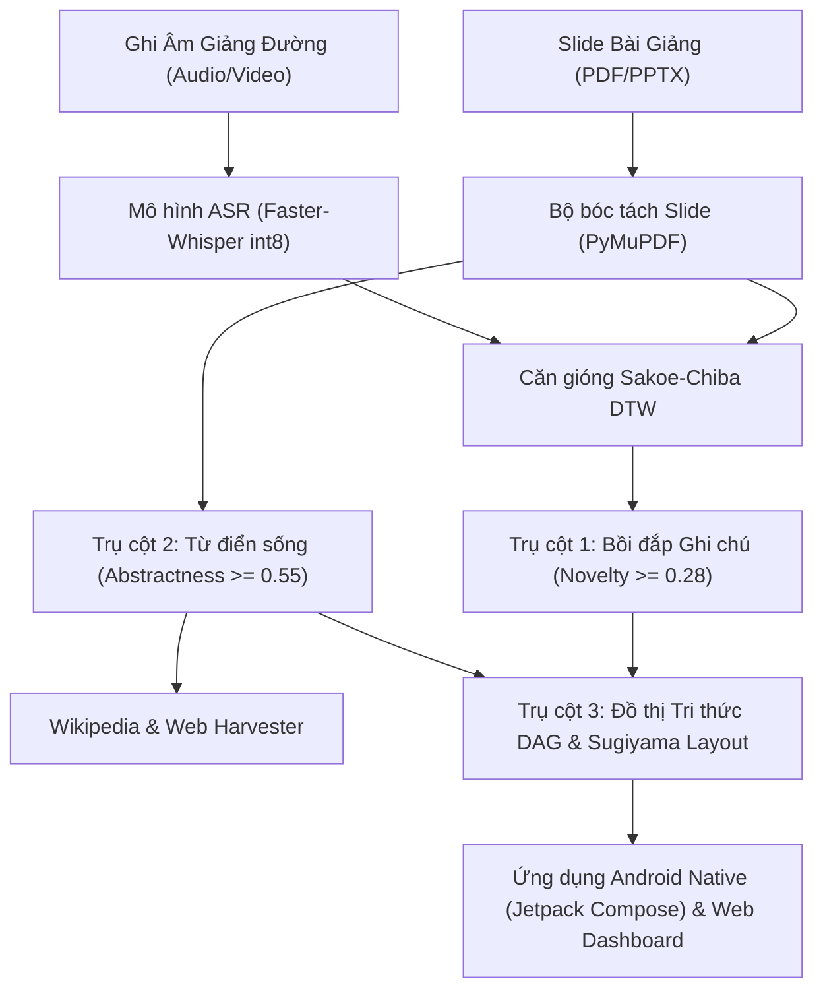

# StudyAI: Công Cụ Học Tập & Trợ Lý Bài Giảng Thông Minh
> **Đồ án Cơ sở 4 / Đề tài Nghiên cứu Khoa học**  
> **Trường Đại học Công nghệ Thông tin & Truyền thông Việt - Hàn (VKU) - Đại học Đà Nẵng**

---

## 👨‍💻 Thông Tin Đề Tài & Tác Giả
- **Sinh viên thực hiện:** Đàm Văn Nguyên
- **Mã sinh viên:** 24IT180 — **Lớp:** 24JIT
- **Giảng viên hướng dẫn:** TS. Trần Uyên Trang
- **Tên đề tài:** *Nghiên cứu, xây dựng hệ thống trợ lý AI hỗ trợ học tập (StudyAI / FocusBoard)*

---

## 🌟 Giới Thiệu Tổng Quan
**StudyAI** là nền tảng trợ lý học tập thế hệ mới giải quyết vấn đề cốt lõi của sinh viên khi theo dõi bài giảng đại học:
- **Nỗi đau thực tế:** Slide bài giảng chỉ chứa các tiêu đề và công thức tóm tắt (khung sườn), trong khi hơn 70% kiến thức chuyên sâu, mẹo thực hành và cảnh báo bẫy lỗi lại nằm ở **lời giảng nói của giảng viên**. Sinh viên ghi chép tay thường bị gián đoạn, bỏ sót ý hoặc gặp ảo giác khi tóm tắt bằng LLM truyền thống.
- **Giải pháp của StudyAI:** Tự động lắng nghe audio giảng đường, căn gióng từng mili-giây với slide bài giảng, bóc tách phần giảng mở rộng ngoài slide với bằng chứng gốc (Verbatim Grounding), tra cứu thuật ngữ chuyên sâu từ nguồn học thuật uy tín và hệ thống hóa thành đồ thị tri thức môn học (DAG).



---

## 🏛️ 3 Trụ Cột Học Thuật Cốt Lõi

### 1. Trụ Cột 1: Căn Gióng Lời Giảng & Bồi Đắp Khung Sườn Slide
- **Monotonic Dynamic Time Warping (DTW):** Áp dụng dải băng Sakoe-Chiba constraint để căn gióng thứ tự lời giảng với các trang slide, đảm bảo tính đơn điệu thời gian.
- **Bộ lọc Novelty & MMR:** Chỉ trích xuất những câu giảng mang thông tin mới vượt ngưỡng $\mathcal{N}(u_j, \mathcal{S}_k) \ge 0.28$ so với slide.
- **100% Verbatim Grounding:** Mọi gạch đầu dòng ghi chép đều gắn kèm trích dẫn nguyên văn câu nói của giảng viên kèm mốc mili-giây chính xác, loại bỏ hoàn toàn hiện tượng ảo giác (hallucination).

### 2. Trụ Cột 2: "Từ Điển Sống" & Mở Rộng Tài Liệu Tham Khảo Đa Nguồn
- **Sàng lọc thuật ngữ trừu tượng:** Tự động nhận diện các khái niệm kỹ thuật khó trong bài giảng đạt điểm trừu tượng $\mathcal{A}(c, \mathcal{S}_k) \ge 0.55$.
- **Cấu trúc 3 tầng giải nghĩa:**
  - *Tầng 1:* Định nghĩa cô đọng học thuật.
  - *Tầng 2:* Trích đoạn giảng viên giảng trực tiếp trên lớp.
  - *Tầng 3:* Tham khảo mở rộng tự động thu thập từ Wikipedia (VI/EN), Semantic Scholar, Web Tutorials chính thức.

### 3. Trụ Cột 3: Hệ Thống Hóa & Liên Kết Chéo Liên Chương
- **Knowledge DAG:** Biểu diễn quan hệ tiên quyết giữa các khái niệm trong toàn khóa học dưới dạng Đồ thị có hướng không chu trình.
- **Thuật toán Kahn:** Tự động phát hiện và triệt tiêu chu trình logic trong tri thức.
- **Phân tầng Sugiyama:** Trực quan hóa đồ thị mượt mà trên Canvas SVG và Android Native.
- **Cảnh báo sư phạm (Used-Before-Defined):** Cảnh báo sinh viên khi một khái niệm được dùng ở slide trước nhưng chưa từng được định nghĩa ở các chương trước.
- **1-Tap Deep Linking:** Chạm vào bất kỳ khái niệm nào để nhảy ngay đến đúng slide và giây âm thanh định nghĩa gốc.

---

## 📊 Kết Quả Thực Nghiệm Trên Bài Giảng Thực Tế

Hệ thống đã được kiểm nghiệm thực tế trên cả hai tập dữ liệu:
1. **Bài giảng Tiếng Anh:** UC Berkeley CS188 (*Introduction to Artificial Intelligence*, 67 slides, video YouTube).
2. **Bài giảng Tiếng Việt:** Quản trị CSDL SQL Server - #09 Lập trình T-SQL (GV: Lương Trần Hy Hiến, 23 slides, audio 33 phút 47 giây).
   - Đã sinh **Vở ghi chép thông minh**: [`VO_GHI_CHEP_BAI_GIANG_T_SQL.md`](VO_GHI_CHEP_BAI_GIANG_T_SQL.md).
   - Giao diện Notebook trực quan tương tác: [`vo_ghi_chep_tsql.html`](vo_ghi_chep_tsql.html).

---

## 🚀 Cấu Trúc Mã Nguồn

```text
├── app/                          # Android Native App (Kotlin, Jetpack Compose, ExoPlayer, Hilt)
│   ├── src/main/java/com/studyai/
│   │   ├── ui/                   # Giao diện UI (LectureNoteScreen, ConceptGraphScreen, MainStudyAiScreen)
│   │   ├── viewmodel/            # StudyAiViewModel quản lý state đồng bộ audio-slide-note
│   │   └── data/                 # Repository & Retrofit Network Services
├── ai-service/                   # AI Microservice (Python, FastAPI, Faster-Whisper, PyMuPDF)
│   ├── app/modules/lecture_notes/# DTW Alignment, Novelty Filter, MMR Redundancy
│   ├── app/modules/living_dictionary/# Abstractness Scorer, Multi-source Harvester
│   └── app/api/pipeline_routes.py# FastAPI Endpoints
├── dataset_eval/                 # Dữ liệu thực nghiệm, kịch bản test và transcript cache
│   ├── my_test/                  # Thư mục kiểm thử tự động với slide & audio mới
│   └── transcribe_and_test_tsql.py # Kịch bản kiểm thử tự động bài giảng thực tế
├── test_dashboard.html           # Bảng điều khiển kiểm thử tương tác 4 tab trên trình duyệt
├── vo_ghi_chep_tsql.html         # Giao diện Vở ghi chép thông minh tích hợp Web Audio player
├── VO_GHI_CHEP_BAI_GIANG_T_SQL.md # Bản tài liệu Markdown đầy đủ 23 trang bồi đắp lời giảng
└── run_my_lecture.py             # Công cụ 1-click tự động xử lý bất kỳ slide & file nghe mới nào
```

---

## 🛠️ Hướng Dẫn Cài Đặt & Chạy Thử

### 1. Khởi động AI Microservice (FastAPI - Port 8001)
```bash
cd ai-service
pip install -r requirements.txt
python -m uvicorn main:app --host 127.0.0.1 --port 8001
```

### 2. Khởi động Backend API (Laravel - Port 8000)
```bash
cd focusboard-api
composer install
php artisan migrate --seed
php artisan serve --host=127.0.0.1 --port=8000
```

### 3. Kiểm thử với một bài giảng mới bất kỳ
Chỉ cần chạy lệnh:
```bash
python run_my_lecture.py --slide "duong/dan/slide.pdf" --audio "duong/dan/audio.mp3"
```
Hệ thống sẽ tự động bóc tách slide, phiên mã Whisper, căn gióng DTW, lọc ghi chú và mở ngay bảng điều khiển [`test_dashboard.html`](test_dashboard.html) trên trình duyệt để kiểm nghiệm!

---
*Bản quyền nghiên cứu © 2026 Đàm Văn Nguyên - TS. Trần Uyên Trang (VKU).*
