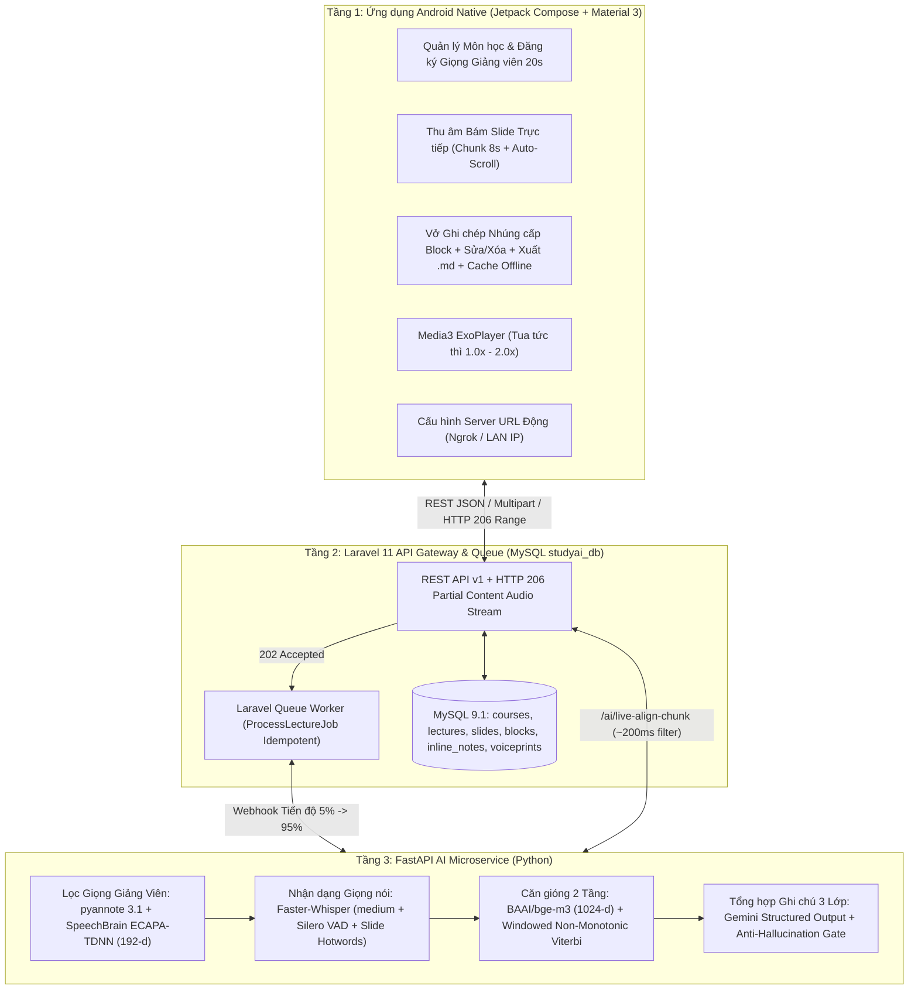

# StudyAI v2.0 — Hệ Thống Trợ Lý AI Hỗ Trợ Ghi Chép & Hệ Thống Hóa Bài Giảng Đại Học
> **Đồ án Cơ sở 4 / Đề tài Nghiên cứu Khoa học**  
> **Trường Đại học Công nghệ Thông tin & Truyền thông Việt - Hàn (VKU) — Đại học Đà Nẵng**

---

## Thông Tin Đề Tài & Tác Giả
- **Sinh viên thực hiện:** Đàm Văn Nguyên — **MSV:** `24IT180` — **Lớp:** `24JIT`
- **Giảng viên hướng dẫn:** TS. Trần Uyên Trang
- **Tên đề tài:** *Nghiên cứu, xây dựng hệ thống trợ lý AI hỗ trợ học tập (StudyAI)*

---

## 1. Tổng Quan & Kiến Trúc Hệ Thống v2.0

**StudyAI** giải quyết bài toán thực tế trên giảng đường đại học ngành CNTT: slide bài giảng thường viết bằng tiếng Anh hoặc chỉ chứa khung sườn/cú pháp ngắn gọn, trong khi phần giải thích bản chất, ví dụ thực chiến và lưu ý thi cử nằm ở lời giảng tiếng Việt (trộn thuật ngữ chuyên ngành) của giảng viên giữa môi trường lớp học nhiều tạp âm.

Hệ thống được thiết kế theo kiến trúc **3 tầng bất đồng bộ** phục vụ song song cả **2 chế độ học tập**: **Batch Upload** (tải cặp Slide + Audio sau buổi học) và **Live Slide-Follow** (thu âm bám slide trực tiếp theo từng chunk 8 giây trên lớp).



---

## 2. Các Đóng Góp Kỹ Thuật Cốt Lõi (v2.0)

1. **Xác thực giọng giảng viên & Lọc nhiễu giảng đường kép (`speaker_verification.py`):**
   - Đăng ký mẫu giọng 20 giây của giảng viên thành vector chuẩn hóa L2 **192 chiều** bằng `speechbrain/spkrec-ecapa-voxceleb`.
   - Chế độ **Batch**: kết hợp `pyannote/speaker-diarization-3.1` và ECAPA-TDNN tách bỏ các đoạn sinh viên bàn tán trước khi căn gióng.
   - Chế độ **Live (chunk 8s)**: gọi `verify_short_chunk(threshold=0.35)` **trước Faster-Whisper**, chặn 100% đoạn nhiễu sinh viên chỉ trong `~166ms` mà không tốn tài nguyên chạy ASR.
2. **Căn gióng Ngữ nghĩa Đa ngôn ngữ 2 Tầng (`semantic_embedder.py`, `alignment.py`):**
   - Sử dụng singleton `BAAI/bge-m3` (1024 chiều) có cache vector kết hợp **khử hubness theo phân vị 25** và **Windowed Non-Monotonic Viterbi** để xử lý bài giảng **Slide tiếng Anh – Giảng tiếng Việt**, phá bỏ hoàn toàn lỗi *"Hố đen Mục lục"* và phục hồi chính xác khi giảng viên lật ngược về slide cũ.
   - Căn cấp **Block (`slide_{N}_b{i}`)**: gắn từng ghi chú vào đúng gạch đầu dòng/đoạn code tương ứng trên trang slide thay vì dồn vào đầu trang.
3. **Tổng hợp Ghi chú 3 Tầng Chống Ảo Giác (`note_synthesizer.py`):**
   - Dùng Pydantic Structured Output với Gemini để biên tập thành 3 nhóm (`core_explanation`, `worked_example`, `exam_tip`).
   - Mọi ghi chú bắt buộc đi qua cổng kiểm chứng xác định `verify_evidence_grounding()` đối chiếu `evidence_quote` với transcript thật của trang slide đó.
4. **Trải nghiệm Học tập Khép kín trên Android (`ExoPlayer` + Offline + Live Merge):**
   - Sau buổi học Live, endpoint `finish-live` tự động ghép các chunk âm thanh bằng `ffmpeg` thành `live_recording.m4a` và phục vụ qua `HTTP 206 Partial Content` để `Media3 ExoPlayer` tua phát ngay ở từng mốc giây ghi chú (`1.0x – 2.0x`), kèm hỗ trợ chỉnh sửa/xóa ghi chú, xuất `.md` và đọc ngoại tuyến (`cache_lecture_{id}.json`).

---

## 3. Kết Quả Thực Nghiệm Đối Chứng (v1 vs. v2)

Số liệu dưới đây được trích xuất trực tiếp từ các tệp báo cáo thực đo trong kho mã nguồn:
- [`ai-service/week2_evaluation_report.json`](ai-service/week2_evaluation_report.json) (Xác thực giọng nói & Lọc nhiễu)
- [`ai-service/week3_evaluation_report.json`](ai-service/week3_evaluation_report.json) (Căn gióng ngữ nghĩa đa ngôn ngữ & Cấp Block)
- [`ai-service/week5_evaluation_report.json`](ai-service/week5_evaluation_report.json) (Bám Slide trực tiếp thời gian thực)
- Bản tổng hợp đầy đủ: [`FINAL_BENCHMARK_SUMMARY.md`](FINAL_BENCHMARK_SUMMARY.md)

| Bài toán đánh giá | Phiên bản cũ (v1) | Phiên bản nâng cấp (v2) | Cải thiện đạt được |
| :--- | :--- | :--- | :--- |
| **Lọc tiếng sinh viên chen ngang (Batch)** | Chưa có (`0%`) | `pyannote` + `ECAPA-TDNN`: **100%** Rejection, **100%** Teacher Recall (EER `0.0%`) | Loại bỏ nhiễu giảng đường |
| **Lọc tiếng sinh viên trực tiếp (Live 8s)** | Chưa có (`0%`) | `verify_short_chunk`: **100%** (`3/3`) chặn trong **166.2ms** | Không tốn thời gian chạy Whisper |
| **Căn gióng bài giảng T-SQL (760s)** | DTW `rapidfuzz`: **78.88%** kẹt Slide 2 | `viterbi_bge_m3`: **100%** trong Slide 1–9, Slide 2 còn **0.31%** | Phá hoàn toàn "Hố đen Mục lục" |
| **Căn gióng song ngữ Việt–Anh (CS188)** | `rapidfuzz`: **22.58%** Top-1 | `viterbi_bge_m3`: **96.77%** Top-1 | Tăng **+74.19 điểm %** |
| **Phục hồi nhảy phi tuyến (Non-Monotonic)** | DTW: **71.43%** (`0/2` quay lại) | `viterbi_bge_m3`: **100.0%** (`5/5` lùi, `2/2` về lại) | Bám sát phong cách giảng tự do |
| **Bám Slide Live (94 chunk × 8s)** | Greedy `rapidfuzz`: **74.47%**, trôi 17 chunk | `windowed_bge_m3_live`: **95.74%**, **0** chunk trôi Slide 15–21 | Ổn định theo thời gian thực |
| **Gắn ghi chú đúng Block trên Slide** | Dồn cứng `b1`: **0.0%** | Semantic Block Mapping: **93.33%** (`14/15`) | Chèn ghi chú đúng từng ý slide |

---

## 4. Cấu Trúc Thư Mục Dự Án

```text
StudyAI/
├── app/                                # Ứng dụng Android Native (Kotlin, Jetpack Compose, Media3 ExoPlayer)
│   └── src/main/java/com/studyai/
│       ├── audio/                      # LectureAudioPlayer (ExoPlayer), ChunkedAudioRecorder (Live 8s)
│       ├── data/                       # ApiClient (URL động SharedPreferences), StudyAiApiService, Models
│       ├── ui/                         # InlineSlideNoteScreen, SlideVaultAndCaptureScreen, Dictionary, Graph
│       └── viewmodel/                  # StudyAiViewModel (Polling Queue, Live Join, Offline Cache)
├── backend/                            # Máy chủ Laravel 11 API Gateway & Queue Worker (MySQL studyai_db)
│   ├── app/Http/Controllers/Api/       # StudyAiUnifiedController, CourseController, LectureUploadController
│   ├── app/Jobs/ProcessLectureJob.php  # Xử lý bất đồng bộ Idempotent + Bảo toàn ghi chú sinh viên sửa
│   └── routes/api.php                  # Định tuyến RESTful API v1 (Stream HTTP 206, CRUD, Live, Export)
├── ai-service/                         # Microservice AI (FastAPI, Python 3.11)
│   ├── app/services/                   # speaker_verification.py, semantic_embedder.py, asr_vad_service.py
│   ├── app/modules/lecture_notes/      # alignment.py (Viterbi BGE-M3), note_synthesizer.py, inline_block_aligner.py
│   ├── evaluate_week2_voice.py         # Benchmark lọc giọng giảng viên & EER
│   ├── evaluate_week3_alignment.py     # Benchmark căn gióng đa ngôn ngữ, phi tuyến & cấp block
│   ├── evaluate_week5_live.py          # Benchmark Live Slide-Follow & lọc giọng tiền-ASR
│   └── run_week6_full_e2e.py           # Kiểm thử toàn trình 5 kịch bản End-to-End trên hệ thống thật
├── dataset_eval/                       # Dữ liệu bài giảng T-SQL, CS188 và bộ nhãn kiểm thử golden_real/
├── FINAL_BENCHMARK_SUMMARY.md          # Báo cáo tổng hợp số liệu thực nghiệm phục vụ Đồ án / NCKH
└── start_servers.bat                   # Script 1-click khởi động Laravel + FastAPI + Queue Worker + Ngrok
```

---

## 5. Hướng Dẫn Cài Đặt Nhanh (Quick Start)

### Bước 1: Cấu hình biến môi trường
1. **AI Microservice (`ai-service/.env`):**
   ```bash
   cd ai-service
   copy .env.example .env
   ```
   Điền `GEMINI_API_KEY` và `HF_TOKEN` (sau khi bấm chấp nhận điều khoản tại `pyannote/speaker-diarization-3.1` trên Hugging Face), sau đó cài thư viện:
   ```bash
   pip install -r requirements.txt
   ```
2. **Backend Laravel (`backend/.env`):**
   Cấu hình kết nối MySQL (`DB_DATABASE=studyai_db`, `QUEUE_CONNECTION=database`) và chạy migration:
   ```bash
   cd backend
   composer install
   php artisan migrate
   ```

### Bước 2: Khởi động toàn bộ cụm Server bằng 1 cú nhấp chuột
Chạy tệp [`start_servers.bat`](start_servers.bat) ở thư mục gốc:
- Tự động bật đồng thời **Laravel API (`:8000`)**, **FastAPI AI (`:8001`)**, **Laravel Queue Worker** và **Ngrok Tunnel**, sau đó tự kiểm tra `/health` và `/api/v1/courses`.

### Bước 3: Build APK & Đổi Server URL trực tiếp trên điện thoại
```bash
.\gradlew.bat assembleDebug
```
- File cài đặt xuất ra tại: `app/build/outputs/apk/debug/app-debug.apk`.
- Khi đổi mạng Wi-Fi hoặc dùng Ngrok mới tại phòng bảo vệ: mở ứng dụng → bấm biểu tượng **Bánh răng (Cấu hình Máy chủ)** trên thanh tiêu đề → dán URL Ngrok hoặc IP LAN (`http://192.168.x.x:8000/`) → bấm **Kiểm tra kết nối** → **Lưu & Tải lại** (không cần build lại APK).

---

## 6. Kịch Bản Demo Bảo Vệ 5 Phút

1. **0:00 – 0:45 | Mở bài trực quan:** Mở bài giảng `TSQL_Lecture09` trên điện thoại → lướt các thẻ `InlineSlideNoteScreen` cho thấy ghi chú gắn đúng dưới từng block code, chạm thuật ngữ mở giải thích, chạm mốc giây `▶ 06:20` để `ExoPlayer` tua và phát đúng giọng giảng viên ở tốc độ `1.5x`.
2. **0:45 – 2:30 | Live Slide-Follow & Lọc nhiễu thời gian thực:** Chuyển sang tab **Thu âm** (đã kích hoạt mẫu giọng giảng viên) → bật **Bám Slide trực tiếp**, phát đoạn sinh viên nói chuyện (hệ thống chặn `ignored_non_teacher`) rồi phát lời giảng của thầy (khối slide tương ứng tự sáng lên và cuộn mượt vào màn hình).
3. **2:30 – 3:45 | Chỉnh sửa, Xuất vở `.md` & Đọc ngoại tuyến:** Bấm menu 3 chấm sửa 1 ghi chú, bấm **Xuất .md** mở Share Sheet, sau đó bật **Chế độ Máy bay** mở lại bài giảng vẫn đọc trọn vẹn từ bộ nhớ đệm kèm nhãn ngoại tuyến.
4. **3:45 – 5:00 | Đối chứng khoa học:** Trình bày bảng kết quả [`FINAL_BENCHMARK_SUMMARY.md`](FINAL_BENCHMARK_SUMMARY.md) (`22.58% → 96.77%` song ngữ, `78.88% → 0.31%` kẹt Slide 2, `100%` lọc nhiễu sinh viên).

---
*Bản quyền nghiên cứu © 2026 Đàm Văn Nguyên — GVHD: TS. Trần Uyên Trang (VKU).*
