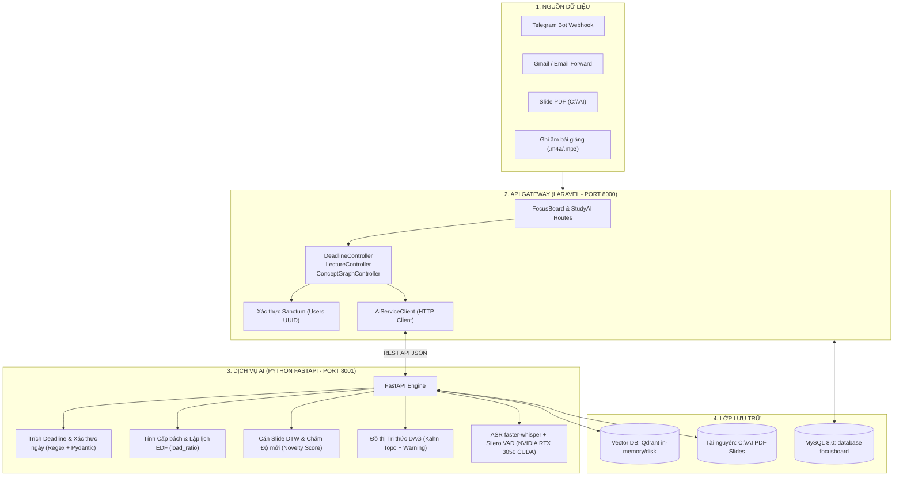

# HƯỚNG DẪN TÍCH HỢP & VẬN HÀNH HỆ THỐNG STUDYAI (FOCUSBOARD)

**Đồ án Cơ sở 4:** Xây dựng trợ lý học tập ứng dụng AI hỗ trợ ghi chú bài giảng bám theo slide, hệ thống hóa kiến thức liên bài và tổng hợp deadline từ nhiều nguồn.  
**Sinh viên thực hiện:** Đàm Văn Nguyên (24IT180 - Lớp 24JIT)  
**Giảng viên hướng dẫn:** TS. Trần Uyên Trang  
**Cập nhật:** 13/10/2026  

---

## 1. Sơ Đồ Kiến Trúc Đã Triển Khai Thực Tế



---

## 2. Danh Mục Các API Endpoints Đã Kiểm Thử Hoàn Tất

### A. Tầng Laravel API Gateway (`http://localhost:8000`)
| STT | Phương thức | Endpoint | Chức năng |
| :---: | :---: | :--- | :--- |
| 1 | `POST` | `/api/webhooks/telegram` | Webhook công khai nhận tin nhắn Telegram chuyển tiếp (Idempotent). |
| 2 | `POST` | `/api/study-ai/deadlines/extract` | Trích xuất deadline từ tin nhắn văn bản, lưu `raw_items` và `tasks`. |
| 3 | `GET` | `/api/study-ai/deadlines/confirmation-queue` | Lấy danh sách việc độ tin cậy thấp cần sinh viên xác nhận. |
| 4 | `POST` | `/api/study-ai/deadlines/{id}/confirm` | Người dùng duyệt/sửa việc trong Hộp xác nhận. |
| 5 | `GET` | `/api/study-ai/deadlines/ranked` | Sắp xếp công việc theo Earliest Deadline First & mức cấp bách `load_ratio`. |
| 6 | `POST` | `/api/study-ai/lectures/upload-and-parse` | Đọc file slide PDF từ `C:\AI` và lưu 25 trang vào bảng `slides`. |
| 7 | `POST` | `/api/study-ai/lectures/{id}/generate-notes` | Căn lời giảng với slide (DTW), tính Novelty Score và lưu `note_items`. |
| 8 | `GET` | `/api/study-ai/lectures/{id}/notes` | Trả về ghi chú bám slide kèm mốc thời gian phát âm thanh. |
| 9 | `GET` | `/api/study-ai/courses/{courseId}/concept-graph` | Trả về đồ thị tri thức DAG, thứ tự học Topo và cảnh báo kiến thức. |
| 10 | `POST` | `/api/study-ai/courses/{courseId}/seed-concepts` | Nạp nhanh các khái niệm và cạnh quan hệ vào MySQL. |

### B. Tầng Python AI Service (`http://127.0.0.1:8001`)
| STT | Phương thức | Endpoint | Chức năng |
| :---: | :---: | :--- | :--- |
| 1 | `GET` | `/health` | Kiểm tra trạng thái AI Service, GPU NVIDIA RTX 3050 và Qdrant. |
| 2 | `POST` | `/api/v1/deadlines/extract` | Tiền lọc Regex $\rightarrow$ LLM Pydantic $\rightarrow$ Parser ngày xác định. |
| 3 | `POST` | `/api/v1/scheduler/rank` | Tính công thức $load\_ratio = \frac{remaining\_effort}{available\_hours}$ và sắp thứ tự ưu tiên. |
| 4 | `POST` | `/api/v1/lectures/parse-slides` | Dùng `pypdf` đọc cấu trúc text từng trang PDF. |
| 5 | `POST` | `/api/v1/lectures/align` | Thuật toán DTW đơn điệu căn audio với slide và tính điểm độ mới Novelty. |
| 6 | `POST` | `/api/v1/graph/validate` | Giải thuật Kahn sắp xếp topo và phát hiện khái niệm dùng trước định nghĩa. |

---

## 3. Hướng Dẫn Vận Hành Hàng Ngày Khi Phát Triển

### Bước 1: Kiểm tra MySQL
* Dịch vụ `MySQL91` đã tự động chạy dưới nền trên cổng `3306`.
* Để kiểm tra: `Get-Service -Name "*mysql*"`

### Bước 2: Khởi động Dịch vụ Python AI (Cổng 8001)
Mở một cửa sổ PowerShell tại thư mục `StudyAI\ai-service`:
```powershell
python -m uvicorn main:app --host 127.0.0.1 --port 8001 --reload
```

### Bước 3: Khởi động Laravel API Gateway (Cổng 8000)
Mở một cửa sổ PowerShell tại thư mục `focusboard-api`:
```powershell
php artisan serve --port=8000
```

### Bước 4: Chạy kiểm thử tự động toàn bộ hệ thống
Tại thư mục `focusboard-api`:
```powershell
php test_study_ai_flow.php
```
> Script này sẽ tự động chạy toàn bộ quy trình: trích xuất deadline, đọc slide PDF thật tại `C:\AI`, căn ghi chú bài giảng theo mốc giây âm thanh, nạp đồ thị khái niệm và tính mức cấp bách theo thời gian thực!
