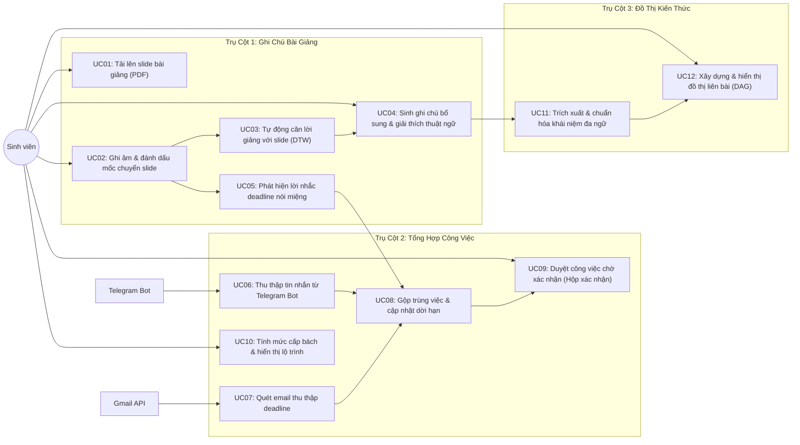

# ĐẦU VÀO PHÂN TÍCH THIẾT KẾ TUẦN 2: DANH SÁCH ACTORS VÀ 12 USE-CASES

**Dự án:** Trợ lý học tập thông minh StudyAI (FocusBoard)  
**Tác giả:** Đàm Văn Nguyên (24IT180 - Lớp 24JIT)  
**Phục vụ:** Giai đoạn 2 (Tuần 2 từ 19/10 đến 25/10) - Vẽ biểu đồ UML & ERD  

---

## 1. Xác Định Các Tác Nhân (Actors)

| STT | Tác Nhân (Actor) | Loại | Mô Tả Vai Trò |
| :---: | :--- | :---: | :--- |
| **1** | **Sinh viên (Student)** | Human / Primary | Người sử dụng ứng dụng di động Android để học tập, xem ghi chú, quản lý công việc và đồ thị tri thức. |
| **2** | **Telegram Bot Service** | External System | Nhận tin nhắn do sinh viên chuyển tiếp, gửi Webhook về Laravel Gateway. |
| **3** | **Mail Server (Gmail API / IMAP)** | External System | Nguồn cung cấp email bài tập, thông báo từ giảng viên hoặc trường. |
| **4** | **Laravel API Gateway** | Core Subsystem | Xác thực người dùng, lưu trữ MySQL, điều phối hàng đợi (Redis) và gửi thông báo qua SSE. |
| **5** | **Python AI Service** | Core Subsystem | Thực thi các tác vụ xử lý ngôn ngữ, ASR (Whisper), Vector Search (Qdrant), DTW căn slide và Knowledge Graph. |

---

## 2. Danh Sách 12 Use-Cases Chi Tiết

### Chi tiết 12 Use-Case:

1. **UC01: Tải lên slide bài giảng (PDF):** Sinh viên tải file slide lên hệ thống; hệ thống trích xuất văn bản từng trang và tạo vector embedding phục vụ căn slide.
2. **UC02: Ghi âm buổi học và đánh dấu chuyển slide:** Sinh viên bấm ghi âm trên app Android và chạm nút đổi trang slide khi giảng viên chuyển slide trong lớp.
3. **UC03: Tự động căn lời giảng với slide (DTW):** Dịch vụ AI dùng Dynamic Time Warping (DTW) so khớp độ tương đồng ngữ nghĩa giữa từng đoạn âm thanh và nội dung slide khi không có mốc bấm tay.
4. **UC04: Sinh ghi chú bổ sung & giải thích thuật ngữ:** So sánh lời giảng với slide để chấm độ mới (Novelty Score), chỉ sinh phần giảng viên giảng thêm ngoài slide, giải thích từ chuyên ngành và gắn mốc phát âm thanh.
5. **UC05: Tự động trích xuất deadline nói miệng:** Bộ phân tích ngôn ngữ phát hiện câu giảng viên giao bài tập trong buổi học (*"nộp bài trước 23h59 ngày 25/10"*) và chuyển vào danh sách công việc.
6. **UC06: Thu thập tin nhắn từ Telegram Bot:** Sinh viên chuyển tiếp (forward) tin nhắn lớp học vào bot; hệ thống lưu bảng `raw_items` an toàn (idempotent).
7. **UC07: Quét email thu thập deadline:** Laravel Scheduler định kỳ thăm dò hộp thư qua Gmail API/IMAP để trích xuất email có chứa từ khóa liên quan bài tập.
8. **UC08: Gộp trùng việc và cập nhật dời hạn:** Dùng embedding và thuật toán đối chiếu thực thể để gộp các thông báo cùng bài tập; tự động đổi ngày khi nhận tin nhắn gia hạn.
9. **UC09: Duyệt công việc chờ xác nhận (Hộp xác nhận):** Những việc có độ tin cậy trích xuất $\tau < 0.85$ hoặc lệch ngày giữa LLM và parser sẽ đưa vào hàng chờ để sinh viên duyệt thủ công.
10. **UC10: Tính mức cấp bách và hiển thị danh sách việc:** Tính $load\_ratio = remaining\_effort / available\_hours$, xếp thứ tự theo mức độ cấp bách để sinh viên ưu tiên làm trước.
11. **UC11: Trích xuất và chuẩn hóa khái niệm liên bài:** Trích xuất khái niệm từ slide/ghi chú nhiều bài, gom cụm cách gọi tiếng Việt và tiếng Anh (*"tiến trình"* và *"process"* về cùng 1 nút).
12. **UC12: Xây dựng và trực quan hóa Đồ thị khái niệm (DAG):** Biểu diễn các cạnh quan hệ tiền đề (`prerequisite_of`, `part_of`), cảnh báo nếu khái niệm bị dùng trước khi định nghĩa và hiển thị đồ thị trên app.
