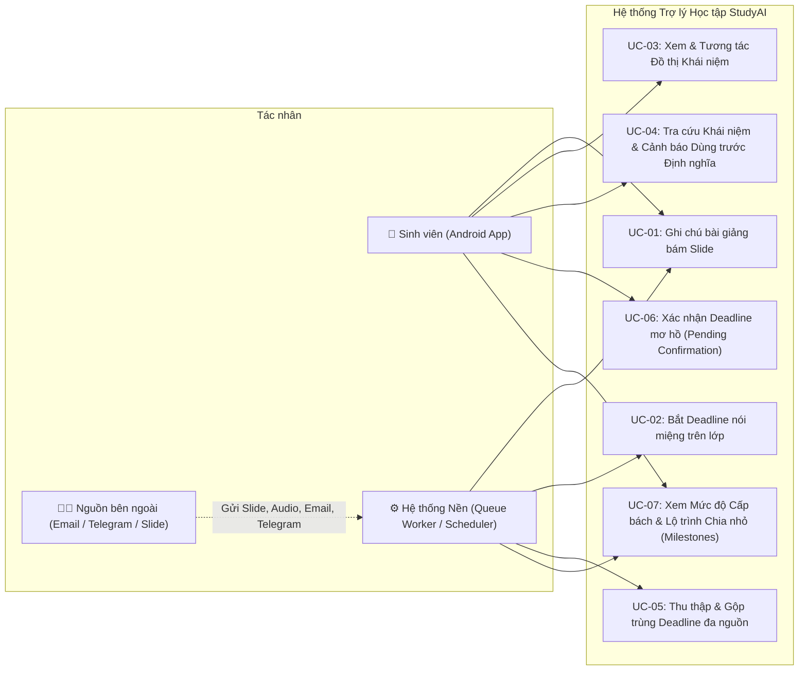
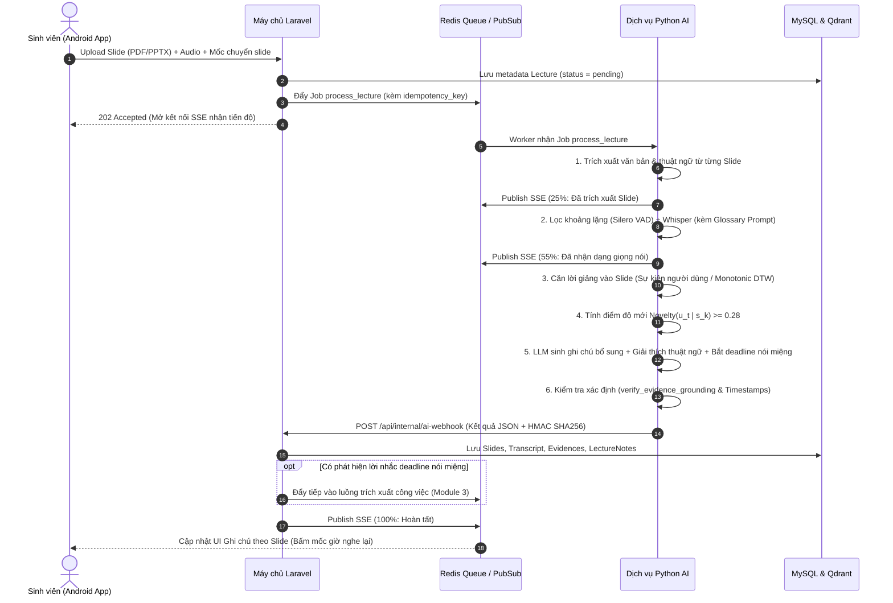
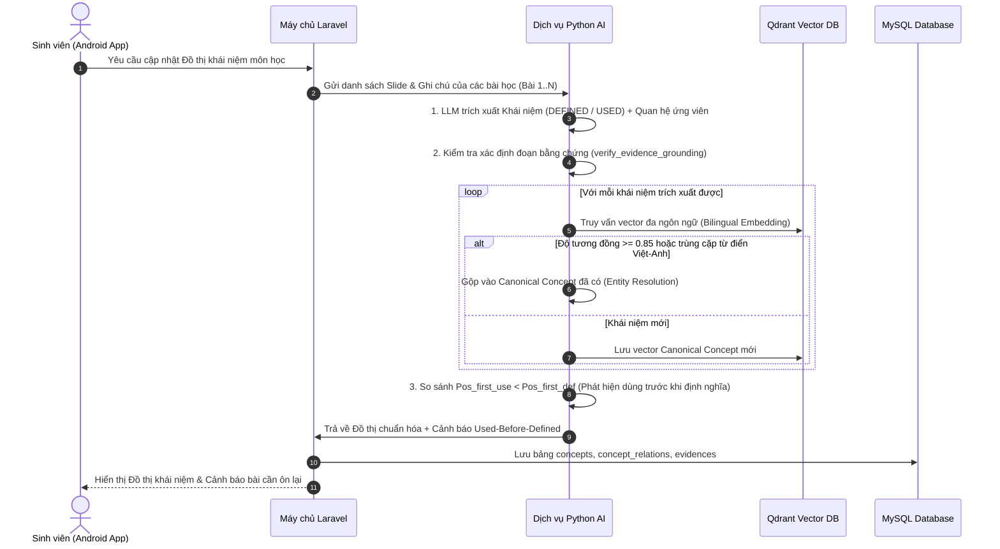
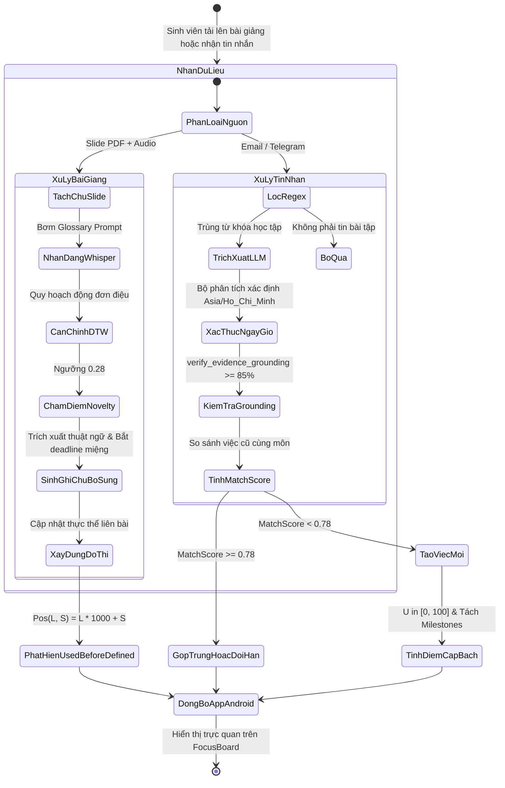
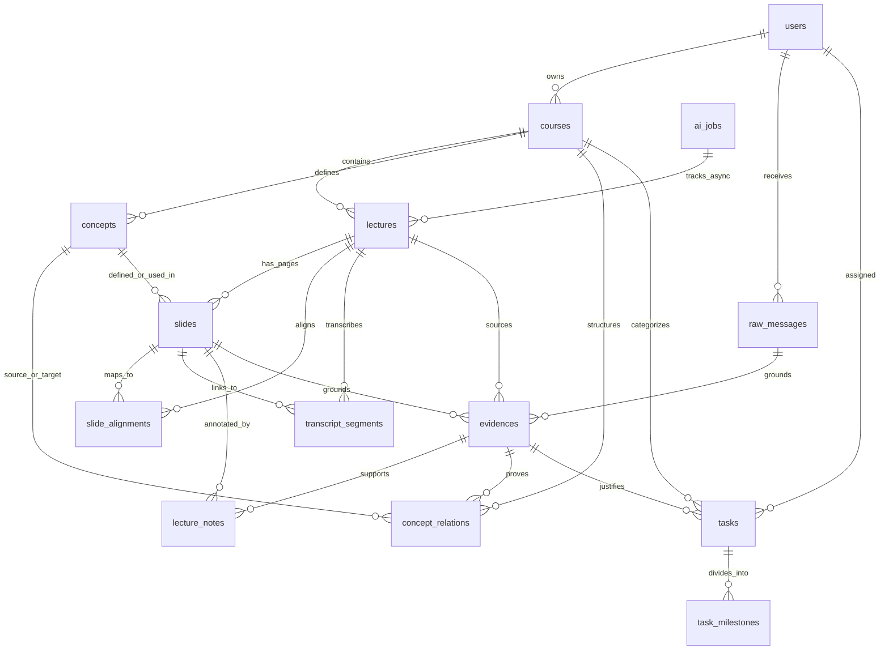

# THIẾT KẾ KIẾN TRÚC & HỆ THỐNG UML (TUẦN 2: 19/10 – 25/10)
**Đề tài:** Xây dựng trợ lý học tập ứng dụng AI hỗ trợ ghi chú bài giảng bám theo slide, hệ thống hóa kiến thức liên bài và tổng hợp deadline từ nhiều nguồn.  
**Sinh viên thực hiện:** Đàm Văn Nguyên (MSV: 24IT180, Lớp: 24JIT - VKU)  
**Giảng viên hướng dẫn:** TS. Trần Uyên Trang  

---

## 1. SƠ ĐỒ USE CASE TỔNG QUAN (USE CASE DIAGRAM)



---

## 2. BA SƠ ĐỒ TRÌNH TỰ CHI TIẾT (SEQUENCE DIAGRAMS)

### 2.1. Sơ đồ Sequence 1: Luồng Ghi chú bài giảng bám Slide & Bắt Deadline nói miệng



---

### 2.2. Sơ đồ Sequence 2: Luồng Xây dựng Đồ thị Khái niệm Liên bài & Cảnh báo Dùng trước Định nghĩa



---

### 2.3. Sơ đồ Sequence 3: Luồng Trích xuất, Xác thực Ngày giờ & Gộp trùng Deadline Đa nguồn

```mermaid
sequenceDiagram
    autonumber
    participant Src as Nguồn (Gmail / Telegram Bot / Lời giảng)
    participant API as Máy chủ Laravel
    participant AI as Dịch vụ Python AI
    participant DB as MySQL & Qdrant
    actor SV as Sinh viên (Android App)

    Src->>API: Tin nhắn / Email mới (kèm received_at)
    API->>DB: Lưu raw_messages (Chống trùng theo external_message_id)
    API->>AI: Đẩy văn bản sang Pipeline Trích xuất công việc
    AI->>AI: 1. Tiền lọc bằng Regex từ khóa học tập
    AI->>AI: 2. LLM trích xuất JSON (title, course, raw_due_expr, evidence_quote, effort)
    AI->>AI: 3. Bộ phân tích ngày giờ xác định (Asia/Ho_Chi_Minh) từ received_at
    AI->>AI: 4. Kiểm tra bằng chứng gốc (verify_evidence_grounding)
    AI->>DB: 5. Tìm công việc cùng môn học để tính MatchScore(T_new, T_existing)
    alt MatchScore >= 0.78 (Công việc trùng hoặc thông báo dời hạn)
        AI->>DB: Gộp bằng chứng mới; cập nhật due_at nếu is_deadline_extension = true
    else Công việc hoàn toàn mới
        alt Độ tin cậy >= 0.75 & Ngày giờ hợp lệ
            AI->>AI: Tách Milestones + Tính điểm cấp bách U(i) kèm câu giải thích
            AI->>DB: Tạo Task mới (status = todo)
        else Độ tin cậy < 0.75 hoặc ngày giờ mơ hồ
            AI->>DB: Đưa vào hàng chờ xác nhận (status = pending_confirmation)
        end
    end
    DB-->>SV: Hiển thị danh sách việc theo Mức cấp bách & Hộp thoại xác nhận việc mơ hồ
```

---

## 3. SƠ ĐỒ HOẠT ĐỘNG TOÀN HỆ THỐNG (ACTIVITY DIAGRAM)



---

## 4. SƠ ĐỒ CƠ SỞ DỮ LIỆU CHUẨN 13 BẢNG (ERD DIAGRAM)


